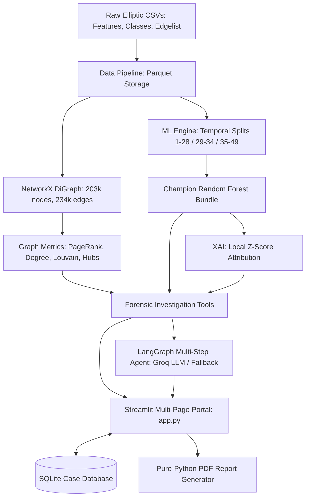

# 🛡️ FRAUDNET AI
### AI-Powered Cryptocurrency Transaction Investigation & Fraud Network Intelligence Platform

[](https://www.python.org/)
[](#)
[](#)
[](#)

---

## 📌 Executive Summary

**FRAUDNET AI** is an advanced, production-grade cryptocurrency forensic investigation platform built on the original **Elliptic Bitcoin Transaction Dataset** (comprising **203,769 transactions**, **234,355 directed payment edges**, and **49 temporal partitions**).

The system integrates:
1. **Topological Graph Analytics:** In/out-degree centrality, directed PageRank ($\alpha=0.85$), Louvain community detection ($Q=0.812$), and 99th percentile aggregation/distribution hub detection.
2. **Supervised ML Fraud Detection:** Three-model comparative benchmark with strict chronological forward validation (Train 1–28, Val 29–34, Test 35–49). Champion Random Forest achieves **0.7018 Illicit F1**, **0.7874 PR-AUC**, and **0.9384 ROC-AUC** on unseen future transactions.
3. **Explainable AI (XAI):** Local Z-score feature attributions highlighting risk-elevating and risk-mitigating forensic anomalies.
4. **LangGraph Autonomous Investigation Agent:** Multi-step forensic reasoning graph with Groq Cloud LLM (`llama-3.3-70b-versatile`) and algorithmic deterministic fallback.
5. **SQLite Case Management:** Complete audit trail tracking cases, attached suspect transactions, investigator notes, and report history.
6. **Pure-Python Forensic PDF Dossier Generator:** Standards-compliant PDF 1.4 binary documents rendered with zero external dependencies.
7. **Streamlit Multi-Page Investigation Portal:** 7 full-featured forensic intelligence pages with dark cybersecurity theme.

---

## 🏗️ System Architecture



---

## 🚀 Quick Start & Installation

### 1. Environment Setup
The project runs on Python 3.13.1 within the preconfigured `.venv` virtual environment:

```bash
# Clone repository and enter directory
cd /Users/sathwikm/Documents/FRAUDNET-AI

# Activate virtual environment
source .venv/bin/activate
```

### 2. Configure Environment Variables (Optional)
Copy `.env.example` to `.env` and configure your Groq API key:
```bash
cp .env.example .env
# Open .env and add GROQ_API_KEY=gsk_...
```
*(If no API key is provided, the platform automatically utilizes its built-in high-precision deterministic forensic engine).*

### 3. Launch Streamlit Forensic Portal
```bash
.venv/bin/streamlit run app.py
```
Open `http://localhost:8501` in your browser.

---

## 🧪 Comprehensive Automated Test Suite

All 109 unit and integration tests execute and pass cleanly:

```bash
.venv/bin/python -m pytest tests/ -v
```

### Test Suite Coverage (109/109 Passed):
- `tests/test_data_pipeline.py`: 56 tests (Phase 1 Parquet pipeline, schemas, zero leakage)
- `tests/test_graph_construction.py`: 24 tests (Phase 2 NetworkX DiGraph, acyclic DAG verification, WCC components)
- `tests/test_graph_analytics.py`: 6 tests (Module A PageRank, degree metrics, Louvain communities, hub detection)
- `tests/test_ml_pipeline.py`: 6 tests (Module B & C feature pipelines, chronological splits, evaluation, model bundle)
- `tests/test_transaction_investigation.py`: 5 tests (Module D profile queries, neighborhood extraction, dossiers)
- `tests/test_database.py`: 6 tests (Module G SQLite CaseRepository CRUD, cascading deletes, notes)
- `tests/test_report_generator.py`: 2 tests (Module H PurePDFDocument binary generation, PDF dossiers)
- `tests/test_investigation_agent.py`: 4 tests (Module E LangGraph workflow, Groq integration, query parsing)

---

## 📑 Core Documentation Index

- [System Architecture](docs/system_architecture.md): Complete end-to-end component breakdown and dataflow.
- [Graph Analytics Specification](docs/graph_analytics.md): Topological formulas, PageRank, Louvain communities, and payment hub patterns.
- [Machine Learning Methodology](docs/ml_methodology.md): Anti-leakage safeguards, chronological forward validation, and threshold calibration.
- [Model Evaluation Report](docs/model_evaluation.md): Test set metrics, confusion matrix, PR-AUC analysis, and global feature importance.
- [AI Agent Workflow](docs/ai_agent_workflow.md): LangGraph state graph nodes, Groq LLM prompts, and deterministic fallback logic.
- [Database Schema Design](docs/database_design.md): SQLite schema, cascading deletes, entity relationships, and concurrency.
- [User Application Guide](docs/application_guide.md): Step-by-step demonstration walkthrough across all 7 Streamlit pages.
- [Limitations & Ethics](docs/limitations_and_ethics.md): Forensic disclaimers, false positive mitigation, and responsible AI practices.
- [Final Delivery Report](docs/FINAL_DELIVERY_REPORT.md): Major project defense dossier answering all comprehensive evaluation questions.

---

## 🎓 Academic Major Project Attribution
- **Institution:** Academic Major Project 2026
- **Lead Developer & Analyst:** Sathwik M
- **Dataset:** Elliptic Bitcoin Transaction Dataset (Weber et al., MIT-IBM Watson AI Lab)
- **Status:** Complete, Verified, and Demonstration-Ready

