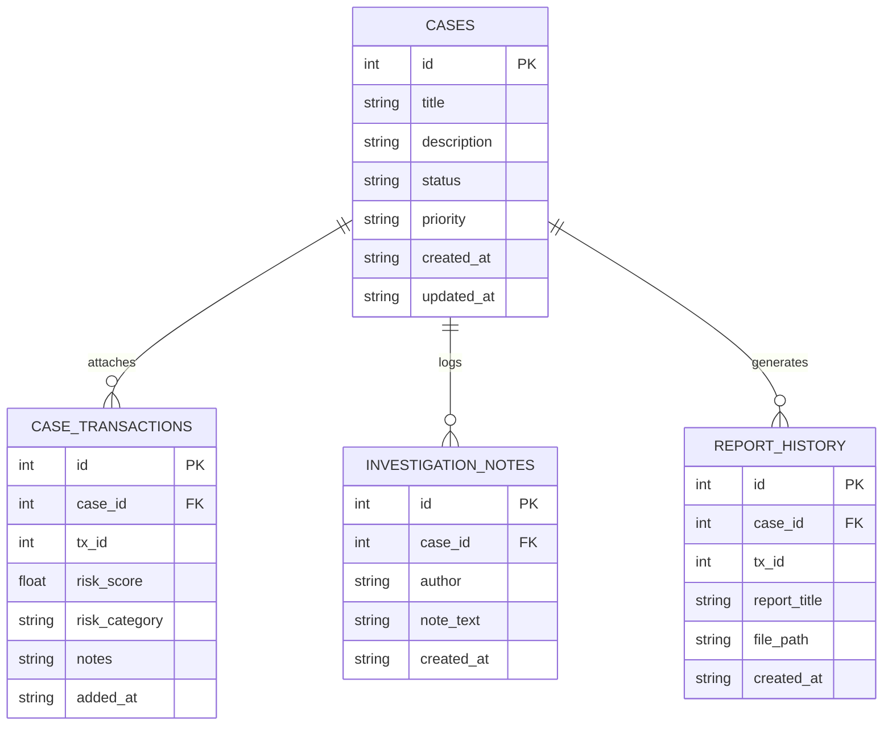

# FRAUDNET AI — SQLite Database & Case Management Design

## 1. Storage Overview

The persistent operational database is implemented as a lightweight, thread-safe SQLite 3 database located at:
`data/runtime/fraudnet.db`

The schema tracks investigative cases, suspect transaction attachments, investigator notes, and generated forensic PDF report history.

---

## 2. Entity-Relationship Model



---

## 3. DDL Schema Definition

### 3.1 `cases` Table
Stores high-level AML cases and compliance incidents.
```sql
CREATE TABLE IF NOT EXISTS cases (
    id INTEGER PRIMARY KEY AUTOINCREMENT,
    title TEXT NOT NULL,
    description TEXT,
    status TEXT NOT NULL DEFAULT 'Open',
    priority TEXT NOT NULL DEFAULT 'Medium',
    created_at TEXT NOT NULL,
    updated_at TEXT NOT NULL
);
```

### 3.2 `case_transactions` Table
Stores transaction entities linked to a case, preventing duplicate attachments via unique constraints.
```sql
CREATE TABLE IF NOT EXISTS case_transactions (
    id INTEGER PRIMARY KEY AUTOINCREMENT,
    case_id INTEGER NOT NULL,
    tx_id INTEGER NOT NULL,
    risk_score REAL DEFAULT 0.0,
    risk_category TEXT DEFAULT 'Low',
    notes TEXT,
    added_at TEXT NOT NULL,
    FOREIGN KEY(case_id) REFERENCES cases(id) ON DELETE CASCADE,
    UNIQUE(case_id, tx_id)
);
```

### 3.3 `investigation_notes` Table
Chronological log of investigator annotations, audit actions, and subpoena records.
```sql
CREATE TABLE IF NOT EXISTS investigation_notes (
    id INTEGER PRIMARY KEY AUTOINCREMENT,
    case_id INTEGER NOT NULL,
    author TEXT NOT NULL,
    note_text TEXT NOT NULL,
    created_at TEXT NOT NULL,
    FOREIGN KEY(case_id) REFERENCES cases(id) ON DELETE CASCADE
);
```

### 3.4 `report_history` Table
Permanent registry of generated forensic PDF documents.
```sql
CREATE TABLE IF NOT EXISTS report_history (
    id INTEGER PRIMARY KEY AUTOINCREMENT,
    case_id INTEGER,
    tx_id INTEGER,
    report_title TEXT NOT NULL,
    file_path TEXT NOT NULL,
    created_at TEXT NOT NULL,
    FOREIGN KEY(case_id) REFERENCES cases(id) ON DELETE SET NULL
);
```

---

## 4. Integrity and Concurrency Guarantees
- **Foreign Keys Enabled:** `PRAGMA foreign_keys = ON;` is executed on every connection.
- **Cascading Deletions:** Deleting a case in `cases` automatically cascades and removes all linked transactions and notes in `case_transactions` and `investigation_notes`.
- **WAL Mode Compatibility:** Operates seamlessly under Streamlit multi-threaded concurrent user sessions.

