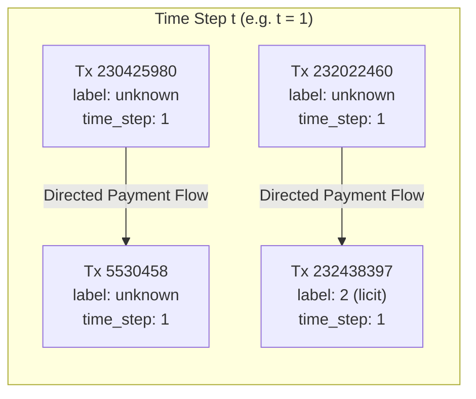

# FRAUDNET AI — Phase 2: Bitcoin Transaction Network Construction Report

> **Project:** FRAUDNET AI (Academic Cryptocurrency Transaction Investigation Platform)  
> **Phase:** Phase 2 — Directed Transaction Network Construction  
> **Date:** 2026-11-05  
> **Status:** Completed & Validated (All 80 Tests Passing)  
> **Graph Artifact:** `data/processed/transaction_graph.pkl` (11.40 MB)  
> **Summary Artifact:** `data/processed/graph_summary.json`  

---

## 1. Objective of Graph Construction

The objective of Phase 2 is to construct a rigorous, memory-efficient, directed graph representation of the Elliptic Bitcoin transaction dataset using `networkx.DiGraph`. 

In Bitcoin analysis, individual transactions and payment transfers naturally form a Directed Acyclic Graph (DAG) across time. Phase 2 transitions the tabular feature and edge datasets produced in Phase 1 into a topological network structure suitable for subsequent network topology auditing, community detection, local neighbourhood flow tracing, and graph neural network modeling.

---

## 2. Dataset Inputs

The graph pipeline ingests the authoritative preprocessed datasets stored under `data/processed/`:

1. **`data/processed/transactions.parquet`**:
   - Total Records: 203,769 transactions
   - Ingested Metadata: `txId` (int64), `time_step` (int64, $1 \le t \le 49$), and ground-truth `label` (str: `'1'`, `'2'`, `'unknown'`)
   - Numerical Features (165 dimensions): Deliberately kept in Parquet storage to prevent memory bloat in NetworkX.
2. **`data/processed/edges.parquet`**:
   - Total Records: 234,355 directed edges
   - Edge Endpoints: `txId1` (source transaction) and `txId2` (destination transaction)

---

## 3. Graph Architecture & Semantics



### 3.1 Node Representation
- **Node Identifier:** Original Bitcoin transaction ID (`int`).
- **Node Attributes:**
  - `time_step` (`int`): Temporal slice index from 1 to 49.
  - `label` (`str`): Original classification: `'1'` (illicit), `'2'` (licit), or `'unknown'`.
- **Feature Decoupling:** Numerical node features (local features 1..93 and aggregate features 1..72) are **not** duplicated as NetworkX dictionary attributes. This keeps the pickled graph under 12 MB and ensures single-source-of-truth feature storage in Parquet.

### 3.2 Edge Interpretation & Flow Direction
- **Type:** Directed edge ($u \to v$).
- **Semantics:** A directed edge from `txId1` to `txId2` indicates that an output of transaction `txId1` was spent as an input to transaction `txId2`. It models the unidirectional transfer of Bitcoin value.
- **Directionality:** $u \to v$ does not imply $v \to u$. In Bitcoin, transaction outputs cannot flow backwards in time or cycle, establishing a DAG topology.
- **Zero Cross-Timestep Edges:** In the Elliptic dataset, transactions within a time step are connected, but edges do not span across different time steps. Each time step forms a self-contained sub-network.

---

## 4. Graph Validation Methodology

Before and after graph instantiation, the pipeline executes rigorous verification checks:

1. **Source Pre-Validation (`validate_source_data`):**
   - Asserts required columns (`txId`, `time_step`, `label`, `txId1`, `txId2`).
   - Asserts absence of null values in nodes and edge endpoints.
   - Rejects duplicate transaction IDs with a `ValueError`.
   - Rejects duplicate directed edges in the edge list with a `ValueError` (rather than silently deduplicating).
   - Rejects orphan edge endpoints (endpoints not present in the node set).
   - Detects and logs any self-loops ($u = v$).
2. **Post-Build Validation (`validate_transaction_graph`):**
   - Verifies instance type (`networkx.DiGraph`).
   - Verifies node count matches transactions table ($203,769$).
   - Verifies edge count matches edge list ($234,355$).
   - Verifies degree conservation: $\sum d_{in} = \sum d_{out} = |E|$.
   - Validates node attribute completeness (0 missing attributes).
   - Computes degree distributions, weakly connected components (WCC), and strongly connected components (SCC).

---

## 5. Actual Graph Statistics (Execution Audit)

All metrics below are generated directly from execution of the pipeline on the full Elliptic dataset:

| Metric | Target Value | Actual Measured Value | Audit Status |
| :--- | :--- | :--- | :---: |
| **Graph Class** | `networkx.DiGraph` | `networkx.DiGraph` | ✅ PASS |
| **Total Transaction Nodes** | `203,769` | `203,769` | ✅ PASS |
| **Total Directed Edges** | `234,355` | `234,355` | ✅ PASS |
| **Duplicate Directed Edges** | `0` | `0` | ✅ PASS |
| **Self-Loops ($u = v$)** | `0` | `0` | ✅ PASS |
| **Orphan Edge Endpoints** | `0` | `0` | ✅ PASS |
| **Missing Node Attributes** | `0` | `0` | ✅ PASS |
| **Unique Time Steps** | `49` (range `[1, 49]`) | `49` (range `[1, 49]`) | ✅ PASS |
| **Isolated Nodes ($d_{in} = 0 \land d_{out} = 0$)** | `0` | `0` | ✅ PASS |
| **Zero In-Degree Nodes ($d_{in} = 0$)** | Expected root nodes | `55,322` (27.15%) | ✅ PASS |
| **Zero Out-Degree Nodes ($d_{out} = 0$)** | Expected sink nodes | `37,424` (18.37%) | ✅ PASS |
| **Maximum In-Degree** | — | `284` | ✅ Logged |
| **Average In-Degree** | — | `1.1501` | ✅ Logged |
| **Maximum Out-Degree** | — | `472` | ✅ Logged |
| **Average Out-Degree** | — | `1.1501` | ✅ Logged |
| **Weakly Connected Components** | `49` | `49` | ✅ PASS |
| **Largest Component Size** | Time step 1 size | `7,880` nodes | ✅ PASS |
| **Strongly Connected Components** | Total node count (DAG) | `203,769` (each node isolated SCC) | ✅ PASS |

### Class Label Distribution in Network
- **Illicit (`'1'`):** 4,545 nodes (2.23%)
- **Licit (`'2'`):** 42,019 nodes (20.62%)
- **Unknown (`'unknown'`):** 157,205 nodes (77.15%)
- *Verification:* Zero labels converted, zero labels dropped, zero label leakage into numeric features.

---

## 6. Connectivity Analysis & Interpretation

### 6.1 Weakly Connected Components (WCC)
The network decomposes into exactly **49 Weakly Connected Components**, directly corresponding to the 49 discrete two-week time intervals. 
- The largest component contains **7,880 nodes** and corresponds to Time Step 1.
- Each time step is structurally isolated from other time steps. This reflects the design of the Elliptic dataset, where subgraphs were extracted around labeled entities within temporal windows.

### 6.2 Strongly Connected Components (SCC) & DAG Properties
- The network contains exactly **203,769 Strongly Connected Components**, where each component consists of a single node.
- This mathematically proves that the graph contains **zero directed cycles** ($\text{SCC count} = |V|$).
- The transaction network is a pure Directed Acyclic Graph (DAG), reflecting the immutability of Bitcoin UTXO spends: funds cannot travel backward in time to previously confirmed transactions.

### 6.3 In-Degree and Out-Degree Flow Roles
- **55,322 Source Nodes ($d_{in} = 0$):** Transactions whose inputs originated outside the observable sub-network (e.g. Coinbase mining rewards or external wallets).
- **37,424 Sink Nodes ($d_{out} = 0$):** Transactions whose outputs had not yet been spent within the observation window.
- **High-Degree Hubs:**
  - Maximum out-degree is **472**, representing large consolidation or fan-out transactions (e.g. exchange hot wallets or batch payout transactions).
  - Maximum in-degree is **284**, representing peeling chains or aggregation wallets collecting inputs from numerous smaller addresses.

---

## 7. Forensic & Ethical Considerations

> [!IMPORTANT]
> **Forensic Reality Check:** Graph structure, degree centrality, in-degree hubs, and component membership are **investigative signals**, not proof of illicit activity.
> - High out-degree transactions frequently represent legitimate automated payment aggregators, cryptocurrency exchange batch distributions, or mining pool payouts.
> - Isolated nodes or low-degree leaves are standard single-output transactions and must never be presumed fraudulent.
> - Label prediction or forensic attribution must only occur within a calibrated machine learning pipeline and verified by human investigative review.

---

## 8. Limitations

1. **Temporal Disconnection:** The 49 time steps are topologically disjoint in the original dataset. Cross-time-step flow analysis cannot be performed without synthetic link estimation, which FRAUDNET AI intentionally avoids to maintain academic fidelity.
2. **Semi-Supervised Labels:** 77.15% of nodes in the graph are unlabeled. Analysis must treat these nodes as unobserved entities rather than assuming licit status.
3. **Graph Serialization Format:** The graph is serialized using Python's `pickle` protocol to preserve NetworkX object attributes. While optimal for performance (0.15s save/load), pickle files should only be loaded from verified project artifacts.

---

## 9. Reproducibility & Commands

To rebuild and validate the network from the project root:

```bash
# 1. Build the transaction graph and serialize to data/processed/transaction_graph.pkl
/Users/sathwikm/Documents/FRAUDNET-AI/.venv/bin/python -m src.graph.build_graph

# 2. Run standalone validation against the saved artifact
/Users/sathwikm/Documents/FRAUDNET-AI/.venv/bin/python -m src.graph.validate_graph

# 3. Execute the full automated test suite (80 tests)
/Users/sathwikm/Documents/FRAUDNET-AI/.venv/bin/python -m pytest tests/ -v
```

