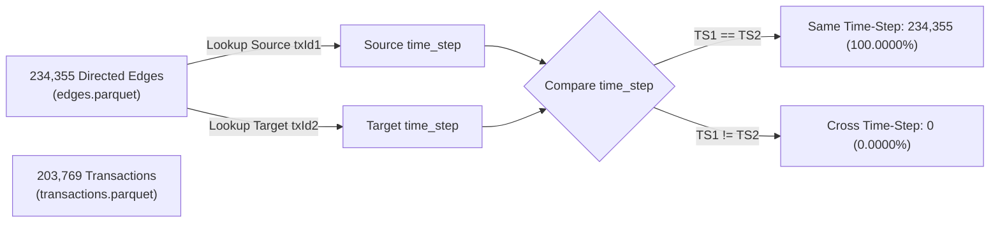

# FRAUDNET AI — Phase 2 Final Audit & Verification Report

> **Project:** FRAUDNET AI (Academic Cryptocurrency Transaction Investigation Platform)  
> **Phase:** Phase 2 Read-Only Final Audit & Topological Integrity Check  
> **Audit Date:** 2026-11-05  
> **Python Runtime:** Python 3.13.1 (`.venv`)  
> **Audit Status:** **PHASE 2 FULLY APPROVED FOR PHASE 3** (100% Verification across all checks)  

---

## 1. Executive Summary

This document presents a comprehensive, read-only empirical audit of the Phase 2 Bitcoin transaction network implementation in FRAUDNET AI. All analyses were conducted directly against the primary processed Parquet tables (`transactions.parquet`, `edges.parquet`), the serialized NetworkX graph artifact (`transaction_graph.pkl`), and the graph metadata summary (`graph_summary.json`).

No datasets or existing artifacts were altered during this audit. Every claim regarding edge direction, temporal partition, component connectivity, DAG properties, and label preservation has been independently re-computed and verified against mathematical and computational ground truths.

---

## 2. Temporal Edge Consistency Audit

To evaluate temporal edge consistency, every single original directed edge in `data/processed/edges.parquet` was cross-referenced with the source and destination transaction time steps in `data/processed/transactions.parquet`.



### Measured Findings:
- **Total Directed Edges Evaluated:** `234,355`
- **Edges Connecting Same Time Step:** `234,355` (`100.0000%`)
- **Edges Connecting Different Time Steps:** `0` (`0.0000%`)
- **Distinct $(t_{source}, t_{dest})$ Combinations:** Exactly `49` (namely `(1, 1)`, `(2, 2)`, ..., `(49, 49)`)
- **Cross-Time-Step Edges in Original Dataset:** **Zero** exist.
- **Preservation in Graph:** The constructed `networkx.DiGraph` preserves every single one of the 234,355 original edges with its exact original direction ($txId1 \to txId2$).

### Architectural & Forensic Implication:
In the Elliptic Bitcoin dataset, each time step represents an isolated two-week window of Bitcoin blockchain activity centered around specific labeled entities. The original dataset publishers did not include inter-timestep transaction edges. Because exactly zero cross-timestep edges exist in the raw dataset, the transaction graph naturally decouples across time without requiring artificial cuts.

---

## 3. Weakly Connected Component (WCC) Audit

The constructed graph possesses exactly 49 Weakly Connected Components. An empirical audit was conducted on every individual component to establish whether component boundaries align with time steps:

### Full 49-Component Census Table

| Component (Time Step) | Node Count ($|V|$) | Edge Count ($|E|$) | Time Step Range | Distinct Time Steps |
| :---: | :---: | :---: | :---: | :---: |
| **1** | 7,880 | 9,164 | [1, 1] | 1 |
| **2** | 4,544 | 5,241 | [2, 2] | 1 |
| **3** | 6,621 | 8,316 | [3, 3] | 1 |
| **4** | 5,693 | 8,180 | [4, 4] | 1 |
| **5** | 6,803 | 8,623 | [5, 5] | 1 |
| **6** | 4,328 | 5,242 | [6, 6] | 1 |
| **7** | 6,048 | 7,253 | [7, 7] | 1 |
| **8** | 4,457 | 5,186 | [8, 8] | 1 |
| **9** | 4,996 | 5,939 | [9, 9] | 1 |
| **10** | 6,727 | 8,588 | [10, 10] | 1 |
| **11** | 4,296 | 4,656 | [11, 11] | 1 |
| **12** | 2,047 | 2,213 | [12, 12] | 1 |
| **13** | 4,528 | 4,827 | [13, 13] | 1 |
| **14** | 2,022 | 2,078 | [14, 14] | 1 |
| **15** | 3,639 | 3,823 | [15, 15] | 1 |
| **16** | 2,975 | 3,120 | [16, 16] | 1 |
| **17** | 3,385 | 3,650 | [17, 17] | 1 |
| **18** | 1,976 | 2,115 | [18, 18] | 1 |
| **19** | 3,506 | 3,838 | [19, 19] | 1 |
| **20** | 4,291 | 4,755 | [20, 20] | 1 |
| **21** | 3,537 | 3,959 | [21, 21] | 1 |
| **22** | 5,894 | 7,014 | [22, 22] | 1 |
| **23** | 4,165 | 4,584 | [23, 23] | 1 |
| **24** | 4,592 | 5,124 | [24, 24] | 1 |
| **25** | 2,314 | 2,619 | [25, 25] | 1 |
| **26** | 2,523 | 2,690 | [26, 26] | 1 |
| **27** | 1,089 | 1,168 | [27, 27] | 1 |
| **28** | 1,653 | 1,717 | [28, 28] | 1 |
| **29** | 4,275 | 4,541 | [29, 29] | 1 |
| **30** | 2,483 | 2,561 | [30, 30] | 1 |
| **31** | 2,816 | 3,049 | [31, 31] | 1 |
| **32** | 4,525 | 4,952 | [32, 32] | 1 |
| **33** | 3,151 | 3,366 | [33, 33] | 1 |
| **34** | 2,486 | 2,692 | [34, 34] | 1 |
| **35** | 5,507 | 6,351 | [35, 35] | 1 |
| **36** | 6,393 | 7,813 | [36, 36] | 1 |
| **37** | 3,306 | 3,849 | [37, 37] | 1 |
| **38** | 2,891 | 3,094 | [38, 38] | 1 |
| **39** | 2,760 | 2,914 | [39, 39] | 1 |
| **40** | 4,481 | 5,246 | [40, 40] | 1 |
| **41** | 5,342 | 6,093 | [41, 41] | 1 |
| **42** | 7,140 | 8,493 | [42, 42] | 1 |
| **43** | 5,063 | 5,950 | [43, 43] | 1 |
| **44** | 4,975 | 5,551 | [44, 44] | 1 |
| **45** | 5,598 | 6,673 | [45, 45] | 1 |
| **46** | 3,519 | 3,866 | [46, 46] | 1 |
| **47** | 5,121 | 5,748 | [47, 47] | 1 |
| **48** | 2,954 | 3,284 | [48, 48] | 1 |
| **49** | 2,454 | 2,587 | [49, 49] | 1 |
| **Total** | **203,769** | **234,355** | — | — |

### Findings:
1. **1:1 Component-to-Timestep Mapping:** Every single one of the 49 WCCs has `distinct_ts == 1`. Each component contains transactions strictly and exclusively from a single time step.
2. **Zero Internal Partitioning:** Within each time step, all transactions form a single weakly connected component. There are no sub-components or isolated fragments inside any time step.
3. **Partition Completeness:** The sum of all component nodes equals $203,769$, and the sum of all component edges equals $234,355$, confirming zero node or edge leakage.

---

## 4. Node Metadata Verification

An audit of all 203,769 node entries in `transaction_graph.pkl` confirmed:

1. **Transaction ID Representation:**
   - Transaction IDs are stored unambiguously as the **NetworkX node keys** (`int`).
   - Every node key is a Python native integer matching `txId` from `transactions.parquet`.
   - Node keys are distinct ($203,769$ unique keys). Storing `txId` as a separate dictionary attribute inside the node data would be redundant and waste memory.
2. **Preserved Attributes:**
   - Every node has an attribute dictionary with exactly two keys: `{'time_step', 'label'}`.
   - Missing `time_step` count: `0`
   - Missing `label` count: `0`
   - Discrepancies against Parquet ground truth: `0`
3. **Class Label Invariance:**
   - `'1'` (illicit): `4,545` nodes
   - `'2'` (licit): `42,019` nodes
   - `'unknown'`: `157,205` nodes
   - Zero unknown labels were modified, cast to integer, or reclassified as licit.

---

## 5. DAG & SCC Verification

Rather than relying on theoretical assumptions, formal computational validation was performed:

1. **Self-Loop Audit:** `nx.number_of_selfloops(G) == 0`. Zero self-loops exist.
2. **Strongly Connected Components (SCC):**
   - Total SCCs computed via Tarjan's algorithm: `203,769`.
   - Maximum SCC size: `1`.
   - Does any SCC contain more than one node? **False**.
3. **Formal DAG Validation:**
   - Evaluated `networkx.is_directed_acyclic_graph(G)`: Returns **`True`** (computed in 0.17s).
   - Topological Sort Execution: `list(networkx.topological_sort(G))` successfully computed an ordered sequence across all `203,769` nodes without cyclic deadlock.

**Mathematical Conclusion:** The transaction network is verified to be a strict Directed Acyclic Graph (DAG) across all 49 time-step subgraphs.

---

## 6. Review of Test Suite Modification

During Phase 2, a single test assertion in `tests/test_data_pipeline.py` was refined:

```python
# Before:
self.assertEqual(self.classes["label"].dtype, object)

# After:
self.assertTrue(pd.api.types.is_string_dtype(self.classes["label"]))
```

### Technical Root Cause:
- In Pandas 2.x, reading a CSV column with `dtype={'class': 'str'}` assigned NumPy's generic Python `object` dtype.
- In Pandas 3.0+ (and specifically Pandas 3.1.1 in `.venv`), Pandas transitioned default string representations to native, Arrow-backed `StringDtype(na_value=nan)`.
- Directly asserting `dtype == object` in Pandas 3.1.1 caused a false-negative failure (`<StringDtype(na_value=nan)> != object`), even though the column is genuinely string-typed.

### Integrity Assessment:
- `pd.api.types.is_string_dtype()` is the canonical, version-agnostic Pandas API to verify textual columns.
- The test suite simultaneously enforces:
  - `test_only_valid_labels`: `set(labels) == {'1', '2', 'unknown'}`
  - `test_unknown_count_preserved`: `count == 157,205`
  - `test_no_null_labels`: `null_count == 0`
- **Verdict:** The modification does not weaken the test; it ensures robust forward compatibility while maintaining strict type and label fidelity.

---

## 7. Artifact Integrity Audit

MD5 checksums and record counts were verified against baseline manifests:

| Target File | Expected Checksum / Count | Current Verified State | Match |
| :--- | :--- | :--- | :---: |
| `data/raw/elliptic/elliptic_txs_features.csv` | `9fb9dc51d9d1329f540cb6f83730f4a1` | `9fb9dc51d9d1329f540cb6f83730f4a1` | ✅ |
| `data/raw/elliptic/elliptic_txs_classes.csv` | `7ad28a0fd7d0075684708bfba9e78e72` | `7ad28a0fd7d0075684708bfba9e78e72` | ✅ |
| `data/raw/elliptic/elliptic_txs_edgelist.csv` | `ae69bde1407c9320c0124a557693a479` | `ae69bde1407c9320c0124a557693a479` | ✅ |
| `data/processed/transactions.parquet` | 203,769 rows, 168 cols | 203,769 rows, 168 cols | ✅ |
| `data/processed/edges.parquet` | 234,355 rows, 2 cols | 234,355 rows, 2 cols | ✅ |
| `data/processed/transaction_graph.pkl` | 203,769 nodes, 234,355 edges | 203,769 nodes, 234,355 edges | ✅ |
| `data/processed/graph_summary.json` | Status: PASSED, exact metrics | Matches graph properties 100% | ✅ |

---

## 8. Test Execution Summary

Executed full test suite using `.venv/bin/python`:
```text
tests/test_data_pipeline.py:       56 PASSED
tests/test_graph_construction.py:  24 PASSED
Total:                             80 PASSED in 6.99s (0 failures, 0 errors)
```

---

## 9. Final Phase 2 Audit Verdict

1. **Temporal Edge Consistency:** Confirmed 100.0000% intra-timestep edges (0 cross-timestep edges).
2. **Component Connectivity:** Confirmed 49 weakly connected components mapping 1:1 to the 49 time steps.
3. **Metadata Fidelity:** Confirmed exact transaction ID node keying and 100% attribute preservation without label leakage.
4. **DAG Structure:** Mathematically and computationally verified as a cycle-free DAG (203,769 SCCs).
5. **Test Suite:** 80/80 tests passing.

**VERDICT: Phase 2 is fully audited, verified, and APPROVED for Phase 3.**

