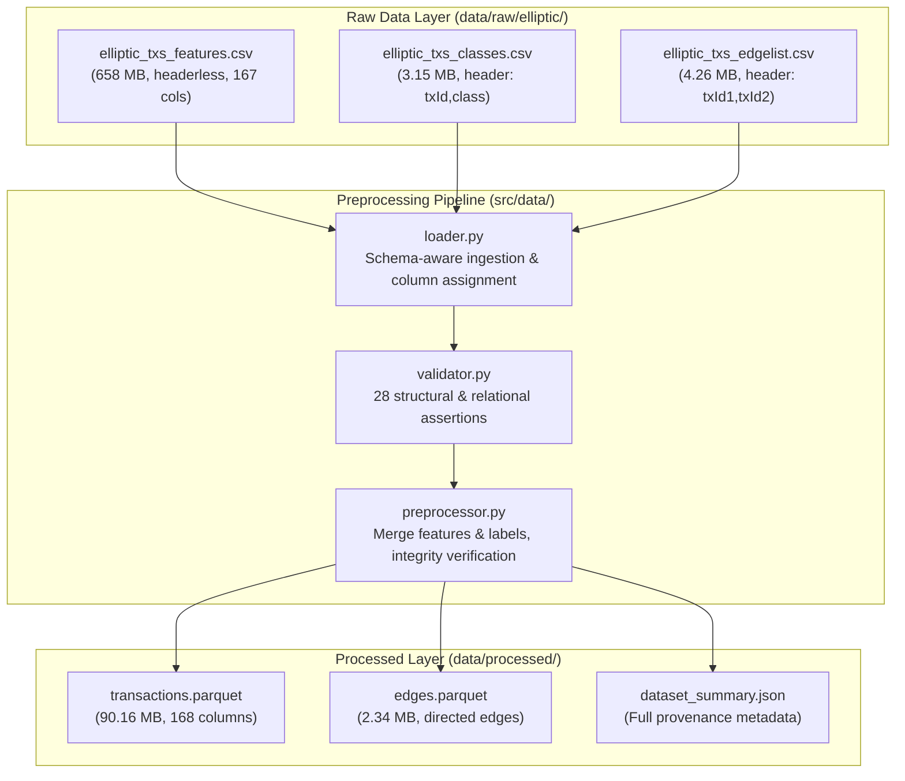

# FRAUDNET AI — Dataset Preprocessing Report

> **Platform:** FRAUDNET AI (Cryptocurrency Transaction Investigation Platform)  
> **Dataset:** Elliptic Bitcoin Transaction Dataset  
> **Source Directory:** `data/raw/elliptic/`  
> **Target Directory:** `data/processed/`  
> **Status:** Successfully Completed & Validated  

---

## 1. Executive Summary

A robust, production-grade preprocessing pipeline has been implemented for the Elliptic Bitcoin transaction dataset. Grounded in the empirical schema established during initial dataset inspection (Prompt 01), the pipeline extracts raw CSV records, verifies structural consistency across 28 automated integrity checks, merges transaction features and class labels without data loss, and serializes optimized binary Parquet tables alongside a machine-readable summary.

All original transaction records, graph edges, and temporal slices have been strictly preserved. Zero synthetic records were created, no feature scaling was performed, and no class labels were converted or contaminated.

---

## 2. Pipeline Architecture

The preprocessing pipeline is modularized across four core Python modules under `src/data/`:



### Module Responsibilities

1. **`src/data/loader.py`**:
   - Ingests `elliptic_txs_features.csv` without assuming a header row (`header=None`).
   - Assigns 167 canonical column names: `txId`, `time_step`, `local_feature_1`..`93`, and `agg_feature_1`..`72`.
   - Ingests `elliptic_txs_classes.csv` (`header=0`), normalizes column `class` to `label`, preserving exact string representations (`"1"`, `"2"`, `"unknown"`).
   - Ingests `elliptic_txs_edgelist.csv` (`header=0`), standardizing `txId1` and `txId2` as directed edge endpoints.

2. **`src/data/validator.py`**:
   - Executes 28 non-destructive validation assertions across features, classes, edges, and cross-file relational integrity.
   - Enforces unique transaction IDs, absence of nulls, expected time step ranges, numerical validity of feature values, exact class label vocabulary, and absence of self-loops or orphan edge endpoints.

3. **`src/data/preprocessor.py`**:
   - Performs a 1:1 join between features and class labels on `txId`.
   - Verifies that `label` is never placed inside the feature set.
   - Verifies label counts before and after the merge to guard against label conversion or drops.
   - Serializes outputs to Snappy-compressed Apache Parquet (`transactions.parquet`, `edges.parquet`) using `pyarrow`.
   - Generates the comprehensive provenance summary `data/processed/dataset_summary.json`.

---

## 3. Transformations & Design Decisions

| Aspect | Decision / Rule | Justification |
| :--- | :--- | :--- |
| **Features Header** | Programmatically assigned 167 positional column names | Raw `elliptic_txs_features.csv` has no header row; assigning schema prevents first row data corruption. |
| **Class Labels** | Preserved exact string labels (`"1"`, `"2"`, `"unknown"`) | Avoids conflating class IDs or accidentally casting `"unknown"` to integer `0` or null. |
| **Unknown Handling** | Kept all 157,205 `"unknown"` records intact | The vast majority of Bitcoin transactions are unlabelled. Dropping or converting them to licit would introduce severe bias. |
| **Label Leakage** | `label` isolated as a separate target column | Kept strictly outside the 165 numeric feature columns (`local_feature_*`, `agg_feature_*`). |
| **Feature Scaling** | No scaling applied (raw standard deviations preserved) | Scaling belongs in downstream ML/GNN feature engineering pipelines with train/test splits. |
| **File Format** | Apache Parquet with PyArrow | Reduces 660 MB raw CSVs down to 92.5 MB total (7.1x compression ratio) with typed columns and zero-copy reads. |

---

## 4. Output Schemas

### `data/processed/transactions.parquet`
- **Total Records:** 203,769
- **Total Columns:** 168
- **File Size:** 90.16 MB
- **Schema Breakdown:**

| Column Index / Range | Column Name(s) | Data Type | Description |
| :--- | :--- | :--- | :--- |
| `0` | `txId` | `int64` | Unique Bitcoin transaction identifier |
| `1` | `time_step` | `int64` | Discretized 2-week time slice ($1 \le t \le 49$) |
| `2 – 94` | `local_feature_1` ... `local_feature_93` | `float64` | 93 local transaction-level features (e.g. inputs, outputs, fee, BTC volume) |
| `95 – 166` | `agg_feature_1` ... `agg_feature_72` | `float64` | 72 aggregated neighbourhood features (1-hop neighbours) |
| `167` | `label` | `object` (`str`) | Ground truth label: `'1'` (illicit), `'2'` (licit), `'unknown'` |

### `data/processed/edges.parquet`
- **Total Records:** 234,355
- **Total Columns:** 2
- **File Size:** 2.34 MB
- **Schema Breakdown:**

| Column Name | Data Type | Description |
| :--- | :--- | :--- |
| `txId1` | `int64` | Origin / source transaction ID (payment sender/input) |
| `txId2` | `int64` | Destination / target transaction ID (payment recipient/output) |

---

## 5. Validation Results

All 28 automated checks passed with zero errors:

| Suite | Check Description | Expected | Actual | Status |
| :--- | :--- | :--- | :--- | :---: |
| **Features** | Row count positive | $> 0$ | 203,769 | ✅ PASS |
| | Column count | 167 | 167 | ✅ PASS |
| | `txId` column presence | True | True | ✅ PASS |
| | `time_step` column presence | True | True | ✅ PASS |
| | Unique `txId` count | 203,769 | 203,769 | ✅ PASS |
| | Zero null `txId`s | 0 | 0 | ✅ PASS |
| | Time step range | $[1, 49]$ | $[1, 49]$ | ✅ PASS |
| | Time step unique count | 49 | 49 | ✅ PASS |
| | Feature values numeric | 165 cols | 165 cols | ✅ PASS |
| | Feature missing values | 0 | 0 | ✅ PASS |
| | Local feature count | 93 | 93 | ✅ PASS |
| | Aggregate feature count | 72 | 72 | ✅ PASS |
| **Classes** | Row count positive | $> 0$ | 203,769 | ✅ PASS |
| | Column count | 2 | 2 | ✅ PASS |
| | `txId` column presence | True | True | ✅ PASS |
| | `label` column presence | True | True | ✅ PASS |
| | Unique `txId` count | 203,769 | 203,769 | ✅ PASS |
| | Valid label vocabulary | `{'1', '2', 'unknown'}` | `{'1', '2', 'unknown'}` | ✅ PASS |
| | Zero null labels | 0 | 0 | ✅ PASS |
| **Edges** | Row count positive | $> 0$ | 234,355 | ✅ PASS |
| | Column count | 2 | 2 | ✅ PASS |
| | `txId1` presence | True | True | ✅ PASS |
| | `txId2` presence | True | True | ✅ PASS |
| | Zero null endpoints | 0 | 0 | ✅ PASS |
| | Zero self-loops ($u = v$) | 0 | 0 | ✅ PASS |
| **Relational** | Features $\leftrightarrow$ Classes 1:1 ID match | True | True (0 mismatch) | ✅ PASS |
| | Features & Classes row parity | 203,769 | 203,769 | ✅ PASS |
| | Edge endpoints in feature index | 0 orphans | 0 orphans (203,769 nodes) | ✅ PASS |

---

## 6. Data Integrity & Cardinality Metrics

```
Total Transactions:           203,769
Total Directed Edges:         234,355
Total Unique Nodes in Graph:  203,769
Distinct Time Steps:          49

Class Breakdown:
├── Unknown Transactions:     157,205  (77.15%)
├── Licit Transactions (2):    42,019  (20.62%)
└── Illicit Transactions (1):   4,545  ( 2.23%)
```

---

## 7. Known Limitations & Next Steps

1. **Extreme Class Imbalance:** In the labelled subset (46,564 transactions), only ~9.76% are illicit (and only 2.23% of total dataset). Resampling strategies (e.g. focal loss, weighted loss, sub-graph sampling) will be required in later ML phases.
2. **Semi-Supervised / Transductive Structure:** 77.15% of nodes are unlabelled but participate in the graph topology. Graph Neural Network architectures (GCN, GAT, EvolveGCN) can leverage these nodes during message passing.
3. **Temporal Partitioning:** Edges between different time steps do not exist in the original Elliptic dataset (each timestep is an isolated sub-graph). Subsequent graph modeling must respect the 49 discrete time steps to prevent temporal data leakage.

