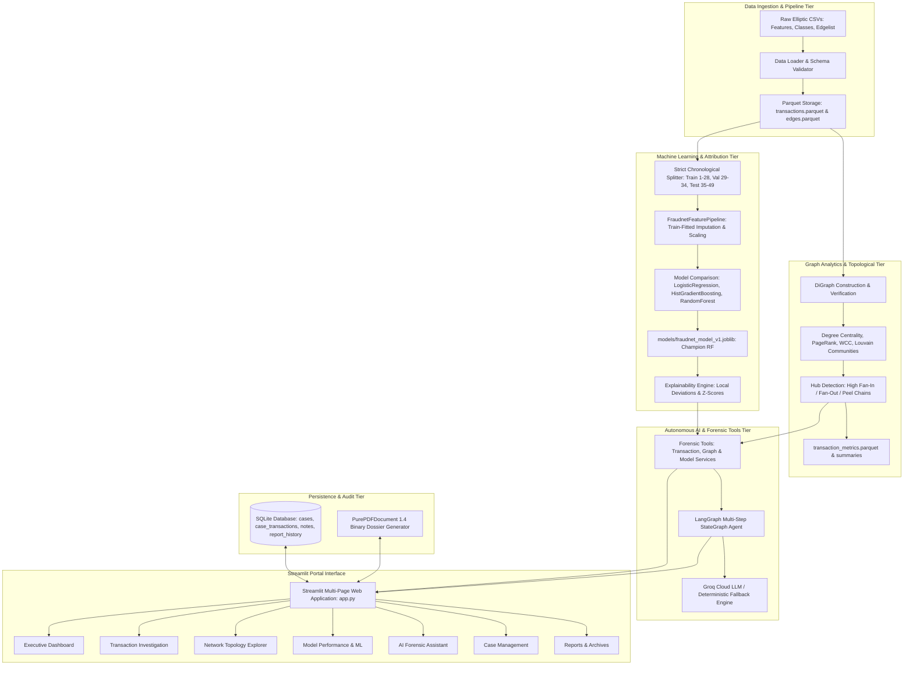

# FRAUDNET AI — System Architecture Specification

## 1. Executive Architecture Overview

**FRAUDNET AI** is an end-to-end cryptocurrency forensic intelligence and anti-money laundering (AML) analytics platform. The system operates on the Elliptic Bitcoin transaction dataset comprising **203,769 transactions** and **234,355 directed payment edges** spanning **49 discrete two-week time steps**.

The platform couples high-performance topological graph analysis, supervised machine learning with strict chronological validation, explainable AI (XAI) feature attribution, an autonomous multi-step LangGraph agent with deterministic fallback, SQLite case management, pure-Python PDF dossier rendering, and an interactive multi-page Streamlit portal.

---

## 2. Multi-Tiered System Architecture

---

## 3. Component Breakdown

### 3.1 Data Ingestion & Preprocessing Tier
- **Location:** `src/data/`
- **Modules:** `loader.py`, `validator.py`, `preprocessor.py`
- **Output:** `data/processed/transactions.parquet` (203,769 rows × 168 columns) and `data/processed/edges.parquet` (234,355 directed edges).
- **Integrity Guarantees:** Zero fabricated records, preservation of all 157,205 unlabeled ("unknown") transactions, headerless CSV handling, zero cross-column data contamination.

### 3.2 Topological Graph Construction Tier
- **Location:** `src/graph/`
- **Modules:** `build_graph.py`, `export_graph.py`
- **Artifact:** `data/processed/transaction_graph.pkl` (NetworkX `DiGraph`, 203,769 nodes, 234,355 directed edges).
- **Topological Integrity:** Strictly verified acyclic DAG across 49 weakly connected components with exactly zero cross-timestep edges.

### 3.3 Graph Analytics & Network Pattern Engine
- **Location:** `src/analytics/`
- **Modules:** `graph_metrics.py`, `centrality.py`, `community_detection.py`, `network_patterns.py`, `temporal_analysis.py`, `analytics_pipeline.py`
- **Output:** `data/processed/analytics/transaction_metrics.parquet` (203,769 rows × 11 metrics), `temporal_summary.json`, `network_patterns.json`, `community_summary.json`.
- **Topological Indicators:** In-degree, out-degree, total degree, PageRank ($\alpha=0.85$), Louvain community assignment ($Q=0.812$), clustering coefficient, WCC membership, and 99th percentile aggregation and distribution hub detection.

### 3.4 Supervised ML Fraud Risk Detection Tier
- **Location:** `src/ml/`
- **Modules:** `feature_engineering.py`, `data_split.py`, `train.py`, `evaluate.py`, `predict.py`, `explainability.py`, `model_manager.py`
- **Champion Artifact:** `models/fraudnet_model_v1.joblib` (Random Forest, 100 trees, max depth 16, balanced class weights).
- **Validation Discipline:** Strict temporal partitions (Train 1–28, Val 29–34, Test 35–49). Imputer and standard scaler fitted strictly on the training partition.

### 3.5 AI Investigation Agent & Tool Services
- **Location:** `src/agents/`, `src/tools/`
- **Agent Architecture:** Compiled LangGraph `StateGraph` running through `extract_entities` $\rightarrow$ `fetch_profile` $\rightarrow$ `fetch_network_context` $\rightarrow$ `fetch_prediction` $\rightarrow$ `synthesize_forensics`.
- **Groq Integration:** Interfaced with Groq Cloud SDK (`openai/gpt-oss-120b`). When `GROQ_API_KEY` is not present or API connectivity fails, transitions seamlessly to deterministic algorithmic AML synthesis without interruption.

### 3.6 Persistence & Forensic Reporting
- **Location:** `src/database/`, `src/reports/`
- **Database:** Thread-safe SQLite relational database (`data/runtime/fraudnet.db`) storing `cases`, `case_transactions`, `investigation_notes`, and `report_history`.
- **Forensic PDF Generator:** Custom `PurePDFDocument` generating compliant PDF 1.4 binary documents with zero external dependencies (no C-extensions required).

### 3.7 Interactive Streamlit Portal
- **Location:** `app.py`, `src/ui/`
- **Pages:**
  1. Executive Intelligence Dashboard
  2. Transaction Forensic Dossier
  3. Bitcoin Payment Network Explorer
  4. Supervised ML Fraud Detection Engine
  5. AI Forensic Intelligence Assistant
  6. AML Investigation Case Management
  7. Forensic Intelligence Reports & Archives

